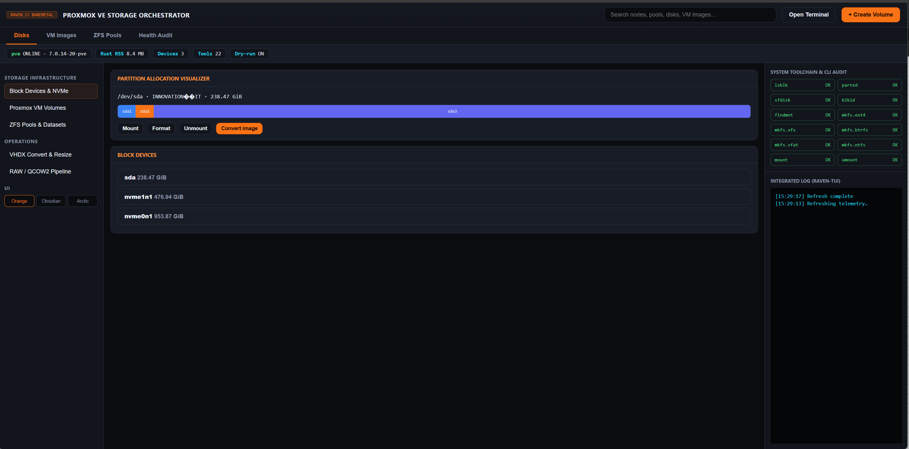
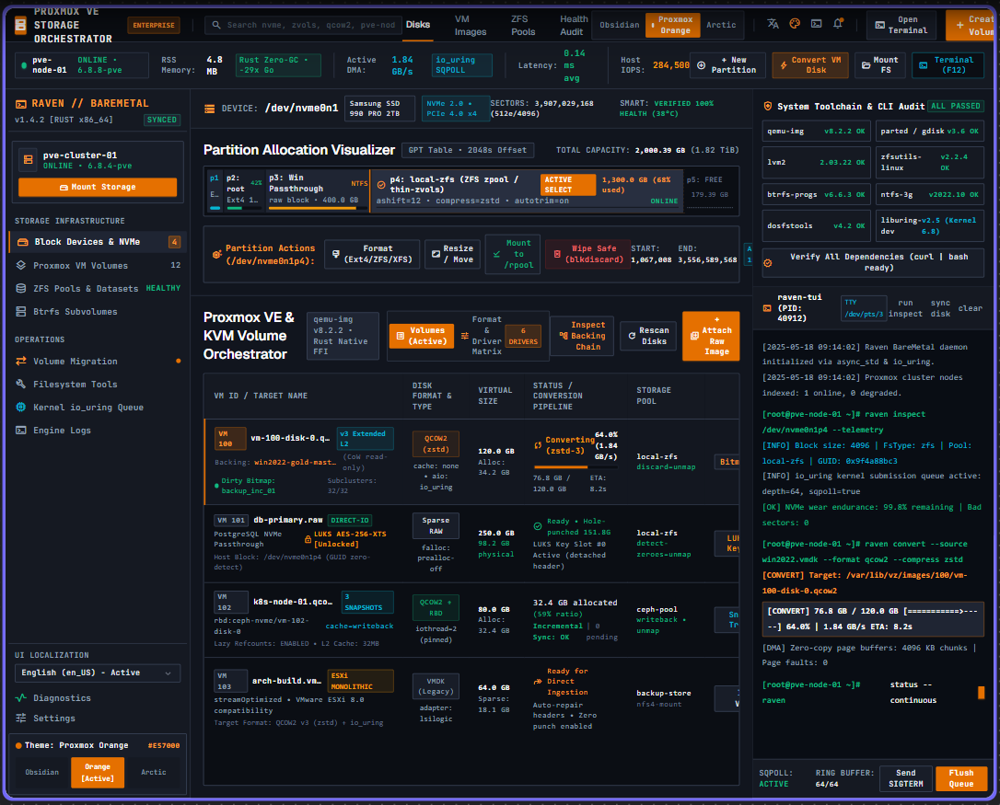
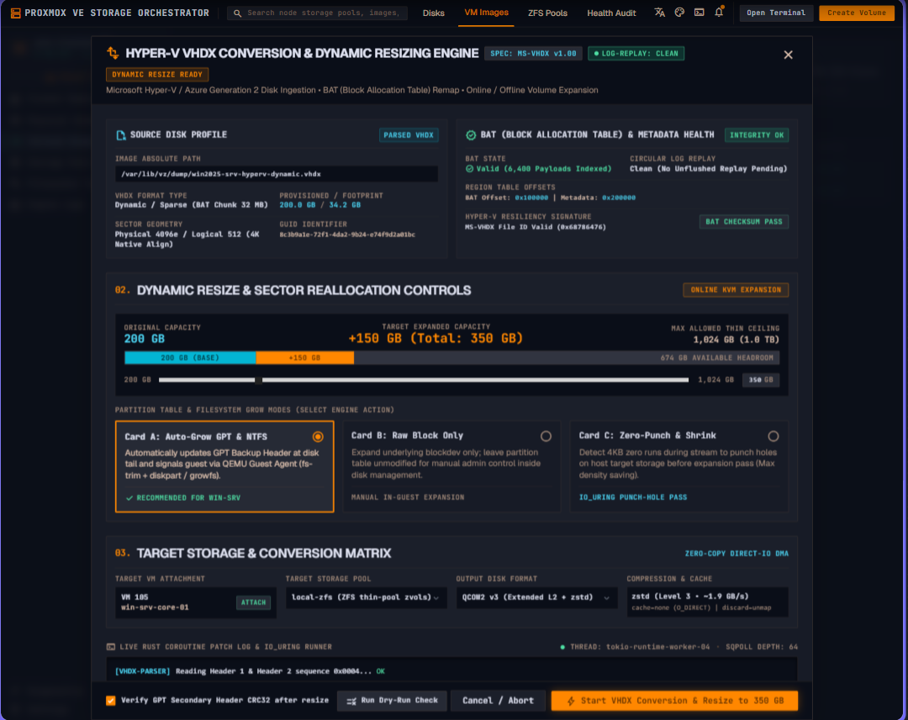
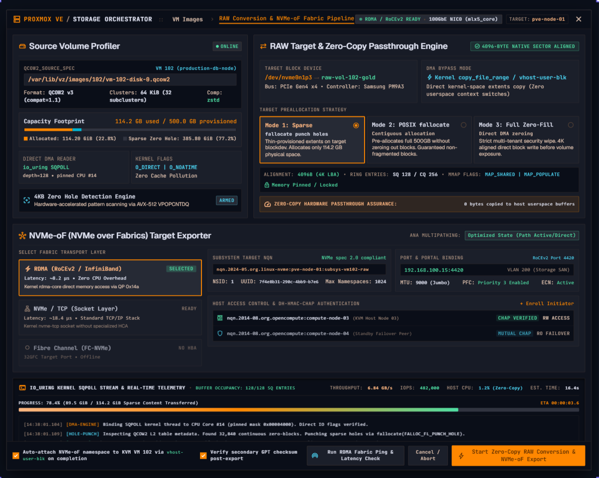

# LPMR — Proxmox VE Storage Orchestrator (Rust)

Lightweight **Rust** control plane for Linux block storage, partitions, LVM, LUKS, ZFS, Proxmox VE (`pvesm`, `qm`), and VM disk images (**RAW, QCOW2, VMDK, VHDX**). The web UI follows the **Raven // Baremetal** orchestrator layout (orange Proxmox enterprise theme, toolchain audit rail, integrated log, conversion modals).

**Languages:** English (default) plus Spanish, Chinese, Hindi, Arabic, French.

## Quick start (one script)

**Proxmox VE / Debian:** do not rely on `apt install cargo` alone — it ships **rustc 1.85**, while this tree needs **≥ 1.88**. `./start.sh` calls `scripts/ensure-rust.sh` and installs **rustup** automatically when needed (`RUSTUP_INIT_SKIP_PATH_CHECK=yes` so it coexists with apt packages).

```bash
git clone https://github.com/ilirix/LPMR.git
cd LPMR
# Until the volume-panel PR merges, use the orchestrator branch:
# git checkout cursor/lpmr-volume-panel-5c83
chmod +x start.sh scripts/ensure-rust.sh
./start.sh
```

On a **Proxmox node** (`pvesm` present), the default bind is **0.0.0.0:8787** so you can open `http://<pve-host>:8787` from your browser. Elsewhere it defaults to **127.0.0.1:8787**. Override with `LPMR_BIND=…`.

`./start.sh` runs in the **foreground** (logs to the terminal; stop with Ctrl+C). For SSH sessions, use background mode:

```bash
LPMR_DAEMON=1 ./start.sh    # writes .lpmr.pid and lpmr-web.log
kill "$(cat .lpmr.pid)"   # stop
```

Fresh Debian smoke test: `chmod +x scripts/debian-fresh-test.sh && ./scripts/debian-fresh-test.sh`

Optional host tools: `LPMR_INSTALL_DEPS=1 ./start.sh`

Equivalent CLI:

```bash
cargo build --release
./target/release/lpmr web --bind 127.0.0.1:8787
./target/release/lpmr tui            # terminal panel
```

## GUI screenshots

> **Note:** `docs/images/gui-orchestrator-main.png` is a **design target** (future cluster / `io_uring` panels). The **shipped web UI** is the **Raven // Baremetal** three-column orchestrator below (same layout as a Proxmox node with `install-deps`).

### Live orchestrator (disks, partition visualizer, toolchain audit, log)



### Design reference (roadmap mockup)



### VHDX conversion & dynamic resize modal



### RAW conversion & export pipeline modal



## Feature reference

### Top bar & navigation

| Element | Function |
|---------|----------|
| **Search** | Filters block devices and VM volume table client-side |
| **Open Terminal** | Hint to run `lpmr tui` for full-screen terminal UI on the host |
| **+ Create Volume** | Modal to create a new `qcow2`/`raw` image (dry-run by default) |
| **Tabs: Disks / VM Images / ZFS / Health** | Switches the center workspace |

### Metrics strip

Live data from `GET /api/telemetry`:

- Hostname & kernel (`/etc/hostname`, `/proc`)
- **Rust RSS** — resident memory of the panel process (typical single-digit MiB)
- Device & tool counts

### Disks workspace

| Feature | Backend |
|---------|---------|
| **Partition visualizer** | `GET /api/partitions?disk=/dev/...` (child partitions vs disk size) |
| **Device list** | `GET /api/devices` (`lsblk` JSON) |
| **Mount / Format / Unmount** | `POST /api/operations` with `dry_run` default |
| **Convert image** | Opens conversion modal → `POST /api/jobs/convert` (`qemu-img convert -p`) |

### VM Images workspace

| Feature | Backend |
|---------|---------|
| Volume table | `GET /api/vm-volumes` (aggregates `pvesm list` on Proxmox nodes) |
| Per-row **Convert** | Pre-fills VHDX/QCOW pipeline modal |

### ZFS Pools workspace

| Feature | Backend |
|---------|---------|
| Pool cards (health, size, free) | `GET /api/zfs/pools` (`zpool list` when `zpool` is installed) |

### Health Audit workspace

| Feature | Backend |
|---------|---------|
| Toolchain grid (OK / missing) | `GET /api/health-audit` |
| Proxmox / ZFS detection flags | Same endpoint |

### Right rail

| Panel | Function |
|-------|----------|
| **System toolchain** | Mirrors Cockpit/Webmin-style dependency audit (`lpmr doctor` data) |
| **Integrated log** | UI + API events; mirrors conversion progress lines |

### Modals (Raven-style pipelines)

1. **VHDX conversion & resize** — source/dest/format, dry-run, async job with progress polling (`GET /api/jobs/:id`).
2. **RAW / QCOW2 pipeline** — same job engine (real `qemu-img` when dry-run off; requires root/capabilities).
3. **Create volume** — `CreateImage` operation via `/api/operations`.

### Terminal UI (`lpmr tui`)

Keyboard-driven Ratatui panel for the same data sets when SSH’d into a node without a browser.

### Enterprise themes (web)

**Orange** (default), **Obsidian**, **Arctic** — CSS variables on `<html data-ui-theme>`.

## Performance notes

| Technique | Why |
|-----------|-----|
| **Rust + Axum** | Single binary, typed `lsblk` parsing, no shell orchestration per request |
| **tower-http gzip** | Compresses JSON/CSS/JS responses for remote Proxmox UI access |
| **Tokio job tasks** | `qemu-img convert` runs off the request thread; UI polls progress |
| **Thin front-end** | Vanilla JS (no React build); fast first paint |

Benchmark device scan: `./target/release/lpmr bench --iterations 100`


## System tools

```bash
sudo ./scripts/install-deps.sh
./target/release/lpmr doctor
```

Includes: `lsblk`, `parted`, `qemu-img`, `lvm`, `cryptsetup`, `ntfs-3g`, `zfsutils-linux` (optional), `pvesm`/`qm` (on PVE).

## REST API summary

| Method | Path | Description |
|--------|------|-------------|
| GET | `/api/health` | Liveness |
| GET | `/api/telemetry` | Host + engine metadata |
| GET | `/api/devices` | Block device tree |
| GET | `/api/partitions?disk=` | Partition map for visualizer |
| GET | `/api/vm-volumes` | Proxmox VM disks |
| GET | `/api/zfs/pools` | ZFS pool list |
| GET | `/api/health-audit` | Toolchain audit |
| POST | `/api/jobs/convert` | Start conversion job |
| GET | `/api/jobs/:id` | Job status & logs |
| POST | `/api/operations` | Partition/mount/format/LUKS/LVM/image ops |

## Project layout

```
start.sh                 # One-shot launcher
crates/lpmr-core         # Storage, ZFS, telemetry, jobs helpers
crates/lpmr-web          # Axum API + static orchestrator UI
crates/lpmr-tui          # Terminal UI
crates/lpmr-cli          # `lpmr` binary
assets/web/              # Orchestrator CSS/JS
docs/images/             # Screenshots & diagrams
```

## Security

- Bind defaults to `0.0.0.0:8787` in `./start.sh` — use firewall or `127.0.0.1` on untrusted networks.
- Destructive actions default to **dry-run**. Run the panel as root only when executing real mutations.

## License

MIT — see [LICENSE](LICENSE).
